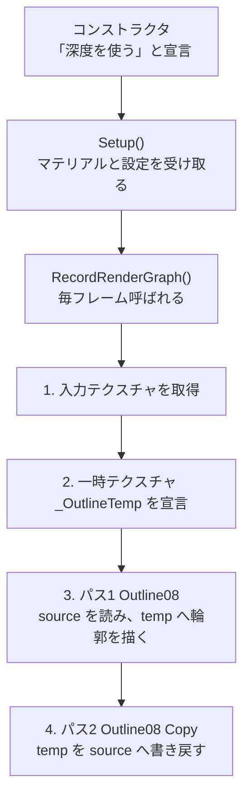
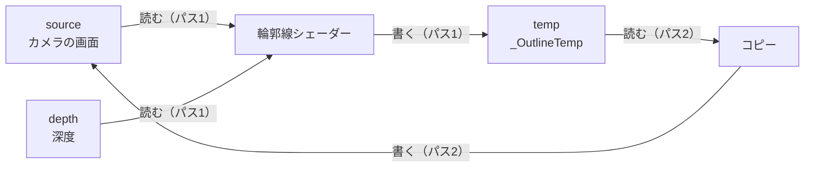
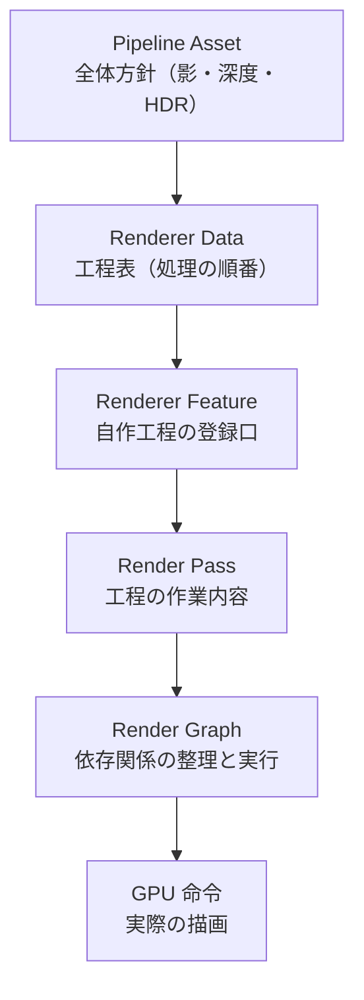
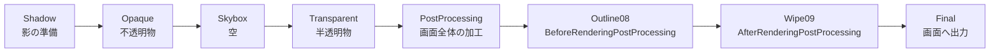
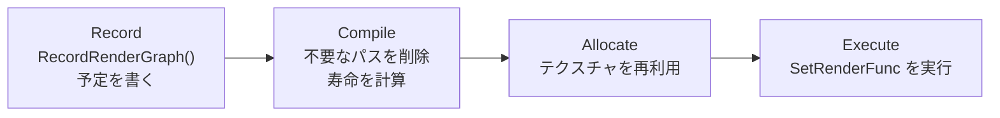
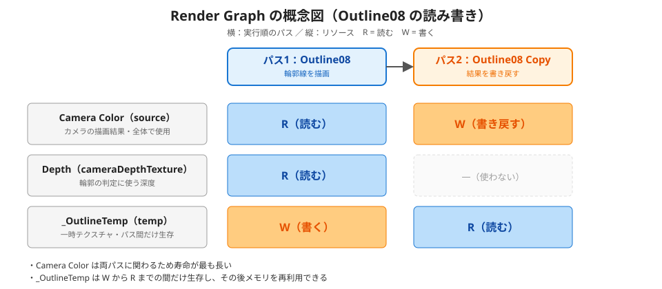
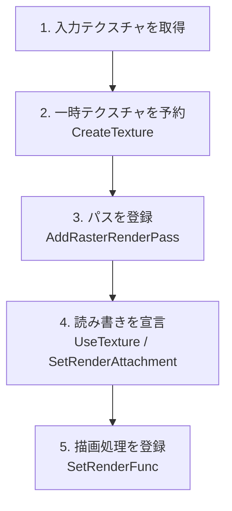
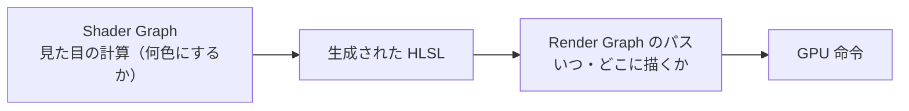
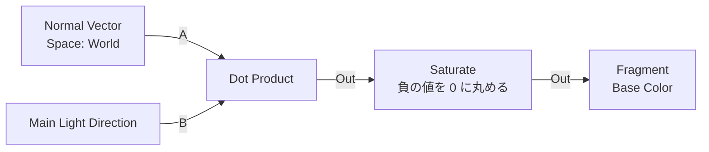
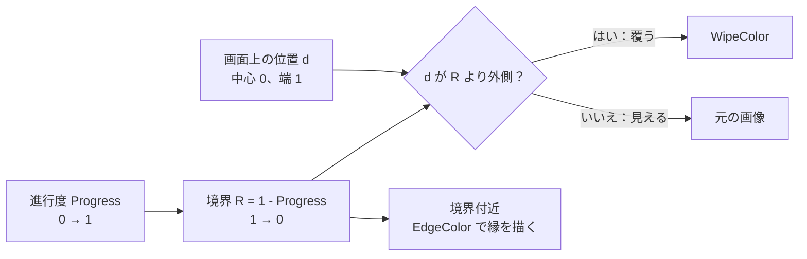

# Chapter 09：Render Graph への移行と Shader Graph による内積の可視化・ワイプ演出

この章は、本プロジェクト（Render Graph 有効）で行います。Chapter 08 の輪郭線を Render Graph 版へ移行し、Render Graph の構造を理解したうえで、Shader Graph でノルマルとライトの内積を可視化して Lit の入力と対応づけます。最後に、Render Graph を使ったワイプ演出を実装します。

> Chapter 08 のステルス（`Stealth08.shader`）とディザリング透過（`Dither08.shader`）は、マテリアルのシェーダーだけで動作します。`Renderer Feature` や `ScriptableRenderPass` を使わないため、移行は不要です。

---

## 0. 移行前の確認と最終的なファイル構成

Chapter 08 の 0 章で `URP_COMPATIBILITY_MODE` を設定している場合は、この章を始める前に次の作業を行ってください。

### 0.1 作業の前提

| 確認項目 | 対処 |
| :--- | :--- |
| `URP_COMPATIBILITY_MODE` が設定されている | Player 設定の Scripting Define Symbols から削除する。残っていると `RecordRenderGraph` が呼ばれず、この章のパスが動きません |
| Graphics 設定で Compatibility Mode が有効 | 無効にし、Render Graph が有効な状態にする |
| `EmptyRendererFeature` が `PC_Renderer` に登録されている | 0.2 の手順で登録を外してからファイルを削除する |
| `Chapter08/OutlinePass.cs` が存在する | 削除する（0.3 参照） |

> **初学者向け補足**：Render Graph が有効かどうかは、「Execute 方式」と「Render Graph 方式」のどちらでパスを書くかを決める設定です。両方を混ぜると、どちらの方式でも正しく動かないため、この章の最初に揃えておきます。

### 0.2 EmptyRendererFeature の削除手順

`EmptyRendererFeature.cs` を削除する前に、登録を外します。登録したままファイルを消すと、Renderer Data の Inspector に `Missing` の表示が残ります。

1. `Assets/Settings/PC_Renderer.asset` を選択する
2. Inspector の Renderer Feature 一覧で **Empty Renderer Feature** を選び、右上のメニュー（⋮）から **Remove** を選ぶ
3. 同じ手順で `Mobile_Renderer.asset` からも外す（登録している場合のみ）
4. `Assets/ShaderProgramming/Chapter08/EmptyRendererFeature.cs` と `EmptyRendererFeature.cs.meta` を削除する

### 0.3 OutlinePass の重複を解消する

Chapter 08 の `OutlinePass.cs`（Execute 版）と、Chapter 09 の `OutlinePass.cs`（Render Graph 版）は、同じ名前のクラス `OutlinePass` を定義しています。Unity では同名のクラスを 2 つ持てないため、どちらか 1 つだけを残します。

| 残すファイル | 判断 |
| :--- | :--- |
| `Assets/ShaderProgramming/Chapter09/OutlinePass.cs` | **残す**。Render Graph 版であり、本章の最終形 |
| `Assets/ShaderProgramming/Chapter08/OutlinePass.cs` | **削除する**。Execute 版で、Render Graph では動作しない |

削除後にコンパイルエラー（CS0101：型 'OutlinePass' は既に定義されています）が消えていれば、この段階は完了です。

### 0.4 RenderGraphBlitUtil.cs を作成する

2.4 で説明する `RenderGraphBlitUtil` は、`OutlinePass.cs` と `WipeRendererFeature.cs` から呼び出されます。このクラスを定義したファイルが無いと、次のエラーが出ます。

> CS0103：現在のコンテキストに 'RenderGraphBlitUtil' という名前は存在しません

ファイル名は `RenderGraphBlitUtil.cs`、クラス名は `RenderGraphBlitUtil` と一致させます。保存先は `Assets/ShaderProgramming/Chapter09/` を推奨します。

### 0.5 最終的なファイル構成

| ファイル | 場所 | 状態 |
| :--- | :--- | :--- |
| `OutlineFullscreen08.shader` | Chapter08 | 変更なし |
| `OutlineRendererFeature.cs` | Chapter08 | `Dispose` を変更（2.5） |
| `OutlinePass.cs` | Chapter09 | Render Graph 版（2.3） |
| `RenderGraphBlitUtil.cs` | Chapter09 | 新規作成（2.4） |
| `OutlinePass.cs`（Execute 版） | Chapter08 | 削除（0.3） |
| `EmptyRendererFeature.cs` | Chapter08 | 削除（0.2） |
| `Dither08.shader` / `Stealth08.shader` / `StealthController.cs` | Chapter08 | 変更なし |
| `NdotLDebug09.shadergraph` | Chapter09 | 新規作成（8 章） |
| `WipeFullscreen09.shader` / `WipeRendererFeature.cs` / `WipeController.cs` | Chapter09 | 新規作成（9 章） |

---

## 1. 学習目標

- Chapter 08 の輪郭線を、`Execute` 方式から `RecordRenderGraph` 方式へ移行できる
- Render パイプラインの階層（Asset・Renderer Data・Feature・Pass）の役割を説明できる
- Render Graph の Record・Compile・Execute の 3 段階を説明できる
- Render Graph Viewer で、パスとリソースの読み書きを読み取れる
- `TextureHandle` と読み書きの宣言を使って、フルスクリーン処理を組み立てられる
- Unlit Shader Graph で法線とライトの内積（N·L）を可視化し、符号と座標空間の意味を確かめられる
- 生成された HLSL の `dot(normalWS, lightDir)` を読み、グラフのノードと対応づけられる
- Lit Shader Graph の入力（Base Color・Normal など）が、ライティング計算のどこに対応するかを説明できる
- Render Graph を使ったワイプ演出を実装し、進行度を C# から制御できる

---

## 1.5 用語の地図（先に読む）

この章では似た名前の用語が多く出てきます。最初に全体像をつかんでおくと、以降の説明が読みやすくなります。

| 用語 | 一言で言うと | たとえ |
| :--- | :--- | :--- |
| Pipeline Asset（`PC_RPAsset`） | 描画全体の基本設定を入れた設定ファイル | 店の営業方針の書類 |
| Renderer Data（`PC_Renderer`） | 描画の段取り（どの処理をどの順に行うか）を決める設定 | 調理の工程表 |
| Renderer Feature | 工程表に後から追加する「自作の工程」の登録口 | 工程表に書き足す項目 |
| Render Pass | 1 つの工程の中身（実際に何をするか） | 工程表の 1 行の作業内容 |
| Render Graph | 1 フレーム分の工程を、依存関係つきで整理して実行する仕組み | 厨房の段取り係 |
| TextureHandle | Render Graph が管理するテクスチャの「引換券」 | 預かり所の番号札 |
| RTHandle（Chapter 08 で使用） | 実際のテクスチャを手動で管理する型 | 自分で持つ鍵 |
| Shader Graph | ノードを線でつないでシェーダーを作るツール | 配線図で作る回路 |

> **初学者向け補足**：Renderer Feature と Render Pass の違いが特に混乱しやすいため注意してください。Feature は「登録口」、Pass は「実際の仕事」です。Feature が Pass を作り、工程表（Renderer）に差し込みます。

---

## 2. Chapter 08 輪郭線の Render Graph 版への移行

### 2.1 移行の対象と対象外

| 項目 | 移行の要否 | 理由 |
| :--- | :--- | :--- |
| `OutlinePass.cs`（Chapter08） | 削除する | Execute 版。Chapter09 の Render Graph 版と同名のクラスのため、残すとコンパイルエラーになる |
| `OutlinePass.cs`（Chapter09） | 新規に用意する（本章で作成） | Render Graph 版の本体 |
| `OutlineRendererFeature.cs` | 一部変更する | `Dispose` でパスの `RTHandle` を解放していたため、その処理を削除する |
| `OutlineFullscreen08.shader` | 変更しない | `Blit.hlsl` の `_BlitTexture` を使うため、Render Graph でも同じ書き方で動く |
| `EmptyRendererFeature.cs` | 削除する | 教材の骨組みとしての役割を終えたため（0.2 参照） |
| `Stealth08.shader` / `StealthController.cs` | 変更しない | マテリアルと `MaterialPropertyBlock` だけで動作するため |
| `Dither08.shader` | 変更しない | 同上 |

### 2.2 Execute と RecordRenderGraph の対応

Chapter 08 の `Execute` では、描画命令を実行時にその場で `CommandBuffer` へ書いていました。Render Graph では、**「宣言する段階」と「実際に描く段階」を分けます**。

| Chapter 08（Execute） | Chapter 09（Render Graph） | 役割 |
| :--- | :--- | :--- |
| `Execute` の中の `Blitter.BlitCameraTexture` | `AddRasterRenderPass` と `SetRenderFunc` | 処理の宣言と、実際の描画命令を分ける |
| `RTHandle _tempTarget` と `Release` | `renderGraph.CreateTexture` | 一時テクスチャは Render Graph が寿命を管理する |
| `ConfigureInput(Depth)` | `builder.UseTexture(depth)` | 読み取るリソースを、パスごとに宣言する |
| `renderingData.cameraData.renderer.cameraColorTargetHandle` | `UniversalResourceData.activeColorTexture` | カメラのカラーを `TextureHandle` で取得する |

> **初学者向け補足**：`RecordRenderGraph` の中ではまだ GPU の描画は行われません。ここでは「どのテクスチャを読み、どのテクスチャに書くか」という**予定表を作る**だけです。実際の描画は、後で呼ばれる `SetRenderFunc` のラムダ式（`(data, ctx) => { ... }` の部分）の中で行われます。料理にたとえると、レシピ（Record）を書く作業と、実際に火をかける作業（Execute）が別の時間に行われる、という関係です。

### 2.3 OutlinePass（Render Graph 版）

`Assets/ShaderProgramming/Chapter09/OutlinePass.cs` を次の内容で作成します。

```csharp
using UnityEngine;
using UnityEngine.Rendering;
using UnityEngine.Rendering.RenderGraphModule;
using UnityEngine.Rendering.Universal;

public class OutlinePass : ScriptableRenderPass
{
    Material _material;
    OutlineRendererFeature.Settings _settings;

    class PassData
    {
        public TextureHandle source;
        public Material material;
    }

    public OutlinePass()
    {
        // 深度を使うことを URP に伝える（Depth Texture を生成させるため）
        ConfigureInput(ScriptableRenderPassInput.Depth);
    }

    public void Setup(Material material, OutlineRendererFeature.Settings settings)
    {
        _material = material;
        _settings = settings;
    }

    public override void RecordRenderGraph(RenderGraph renderGraph, ContextContainer frameData)
    {
        if (_material == null) return;

        UniversalResourceData resourceData = frameData.Get<UniversalResourceData>();

        // 設定値はレコード時にマテリアルへ反映する（描画時に読まれる）
        _material.SetColor("_OutlineColor", _settings.outlineColor);
        _material.SetFloat("_Threshold", _settings.threshold);
        _material.SetFloat("_Sharpness", _settings.sharpness);
        _material.SetFloat("_Thickness", _settings.thickness);

        TextureHandle source = resourceData.activeColorTexture;
        TextureHandle depth = resourceData.cameraDepthTexture;

        // カメラと同じ形式の一時テクスチャを宣言する（深度は不要）
        TextureDesc desc = renderGraph.GetTextureDesc(source);
        desc.name = "_OutlineTemp";
        desc.clearBuffer = false;
        desc.depthBufferBits = DepthBits.None;
        TextureHandle temp = renderGraph.CreateTexture(desc);

        // パス 1：カラーと深度を読み、輪郭を重ねて temp へ書く
        using (var builder = renderGraph.AddRasterRenderPass<PassData>("Outline08", out var passData))
        {
            passData.source = source;
            passData.material = _material;

            builder.UseTexture(source);
            builder.UseTexture(depth);
            builder.SetRenderAttachment(temp, 0);

            builder.SetRenderFunc((PassData data, RasterGraphContext ctx) =>
            {
                Blitter.BlitTexture(ctx.cmd, data.source, new Vector4(1, 1, 0, 0), data.material, 0);
            });
        }

        // パス 2：temp の結果を、カメラのカラーへ戻す
        RenderGraphBlitUtil.AddCopyPass(renderGraph, temp, source, "Outline08 Copy");
    }
}
```

#### 2.3.1 このコードの全体像

処理は次の 4 段階に分かれています。



#### 2.3.2 PassData：パスに値を運ぶ箱

```csharp
class PassData
{
    public TextureHandle source;
    public Material material;
}
```

`RecordRenderGraph` の中で「あとで使う値」を箱に入れ、`SetRenderFunc` のラムダ式がその箱から値を取り出します。`SetRenderFunc` は後で実行されるため、外側の変数（`_settings` など）を直接使うと、実行時に別の値を参照してしまう危険があります。箱を経由させることで、この問題を防ぎます。

#### 2.3.3 コンストラクタ：深度を使うと宣言する

```csharp
ConfigureInput(ScriptableRenderPassInput.Depth);
```

これは「このパスは深度テクスチャを使います」と URP に伝える一行です。URP は、この宣言があるときだけ深度テクスチャを作ります。コンストラクタで一度書けば十分です。

#### 2.3.4 Setup：外部から値を受け取る

`Setup` は、Feature から毎フレーム呼ばれてマテリアルと設定を受け取るだけの関数です。描画はしません。描画は `RecordRenderGraph` で行います。

#### 2.3.5 RecordRenderGraph：予定表を作る

**(1) 入力テクスチャを取得する**

```csharp
UniversalResourceData resourceData = frameData.Get<UniversalResourceData>();
TextureHandle source = resourceData.activeColorTexture;
TextureHandle depth = resourceData.cameraDepthTexture;
```

- `source`：処理対象の画面（カメラのカラー）
- `depth`：深度テクスチャ（物体の前後関係がわかる情報）

`frameData` は、URP がフレームごとに用意した情報の入れ物です。そこから `UniversalResourceData` を取り出すと、カラーや深度の `TextureHandle` が手に入ります。

**(2) 一時テクスチャを宣言する**

```csharp
TextureDesc desc = renderGraph.GetTextureDesc(source);
desc.name = "_OutlineTemp";
desc.clearBuffer = false;
desc.depthBufferBits = DepthBits.None;
TextureHandle temp = renderGraph.CreateTexture(desc);
```

| 行 | 意味 |
| :--- | :--- |
| `GetTextureDesc(source)` | `source` と同じ大きさ・形式の設定を写し取る |
| `desc.name` | Render Graph Viewer に表示される名前 |
| `clearBuffer = false` | 毎回黒く塗りつぶさない（上書きするので不要） |
| `depthBufferBits = None` | 深度を持たない色だけのテクスチャにする |
| `CreateTexture` | 一時テクスチャを予約する。作成と解放は Render Graph が自動で行う |

**なぜ一時テクスチャが必要なのか**：同じテクスチャを「読みながら、同じテクスチャへ書く」と、どの画素が書き換え前か後かが混ざり、結果が壊れます。そこで、読む場所（source）と書く場所（temp）を分けます。

**(3) パス 1：輪郭線を描く**

```csharp
using (var builder = renderGraph.AddRasterRenderPass<PassData>("Outline08", out var passData))
{
    passData.source = source;
    passData.material = _material;

    builder.UseTexture(source);          // 読むテクスチャを宣言
    builder.UseTexture(depth);           // 読むテクスチャを宣言
    builder.SetRenderAttachment(temp, 0); // 書き込み先を宣言（0 番目の出力）

    builder.SetRenderFunc((PassData data, RasterGraphContext ctx) =>
    {
        Blitter.BlitTexture(ctx.cmd, data.source, new Vector4(1, 1, 0, 0), data.material, 0);
    });
}
```

- `AddRasterRenderPass<PassData>("Outline08", ...)`：「描画を行うパス」を登録し、名前を付けます。
- `UseTexture`：**読む**テクスチャを宣言します。Render Graph はこの宣言から「このパスの前に、このテクスチャが準備済みでなければならない」と判断します。
- `SetRenderAttachment`：**書く**先を宣言します。`0` は出力の番号です（複数同時に書く場合は 1、2 と増やします）。
- `SetRenderFunc`：実際の描画処理を登録します。このラムダ式が Execute の段階で呼ばれます。

ラムダ式の中の `Blitter.BlitTexture` の引数は次のとおりです。

| 引数 | 意味 |
| :--- | :--- |
| `ctx.cmd` | GPU への命令を書き込むための記録用の箱 |
| `data.source` | 入力テクスチャ |
| `new Vector4(1, 1, 0, 0)` | 拡大率とずらし量（1, 1 で等倍、0, 0 でずらさない＝画面全体を使う） |
| `data.material` | 輪郭線を計算するマテリアル |
| `0` | マテリアル内の Pass の番号（0 番目を使う） |

この 1 回の Blit で、`OutlineFullscreen08.shader` の `Frag` が画面の画素ごとに実行されます。

**(4) パス 2：結果を戻す**

```csharp
RenderGraphBlitUtil.AddCopyPass(renderGraph, temp, source, "Outline08 Copy");
```

`temp` に描いた結果を、もとの `source` へコピーします。`RenderGraphBlitUtil` の中身は 2.4 で説明します。

#### 2.3.6 処理の流れのまとめ



#### 2.3.7 注意点

- `RecordRenderGraph` は毎フレーム呼ばれます。重い処理を書かないよう注意してください。
- `SetRenderFunc` の中で `this` のフィールド（`_settings` など）を参照しないでください。必要な値は `PassData` 経由で渡します。
- 読むテクスチャを `UseTexture` で宣言し忘れると、描画結果が前フレームのものになったり、黒くなったりします。

> **API の版による差について**：本節の API 名は URP 17.x（Unity 6.x）で一般的な書き方です。`_CameraDepthTexture` の登録方法などはバージョンで変わることがあります。Package Manager の **Universal RP → Samples** に含まれる Render Graph の Fullscreen サンプルと照合してください。

### 2.4 共通のコピーパス（RenderGraphBlitUtil.cs）

コピーの処理は 2 つのパスで使うため、`Assets/ShaderProgramming/Chapter09/RenderGraphBlitUtil.cs` にまとめます。

```csharp
using UnityEngine;
using UnityEngine.Rendering;
using UnityEngine.Rendering.RenderGraphModule;

public static class RenderGraphBlitUtil
{
    class PassData
    {
        public TextureHandle source;
        public Material material;
    }

    // src を dst へ転送する。material が null なら単純コピー
    public static void AddCopyPass(RenderGraph renderGraph, TextureHandle src, TextureHandle dst,
                                   string passName, Material material = null)
    {
        using (var builder = renderGraph.AddRasterRenderPass<PassData>(passName, out var passData))
        {
            passData.source = src;
            passData.material = material;

            builder.UseTexture(src);
            builder.SetRenderAttachment(dst, 0);

            builder.SetRenderFunc((PassData data, RasterGraphContext ctx) =>
            {
                if (data.material != null)
                    Blitter.BlitTexture(ctx.cmd, data.source, new Vector4(1, 1, 0, 0), data.material, 0);
                else
                    Blitter.BlitTexture(ctx.cmd, data.source, new Vector4(1, 1, 0, 0), 0f, false);
            });
        }
    }
}
```

> **初学者向け補足**：`material` を渡すと「加工しながらコピー」、渡さないと「そのままコピー」になります。`static` クラスなので、`new` しなくても `RenderGraphBlitUtil.AddCopyPass(...)` と呼べます。

### 2.5 OutlineRendererFeature の変更点

`Assets/ShaderProgramming/Chapter08/OutlineRendererFeature.cs` は、次の 1 点だけ変更します。

```csharp
protected override void Dispose(bool disposing)
{
    CoreUtils.Destroy(_material);
}
```

`_pass?.Dispose();` を削除する理由は、Render Graph 版の一時テクスチャは Render Graph が自動で解放するため、手動で解放する処理が不要になるからです。

`Create` の `_pass = new OutlinePass { ... }` と、`AddRenderPasses` の処理（ゲームカメラのみ、`EnqueuePass`）はそのまま動きます。`OutlinePass` は Chapter09 フォルダにありますが、同じプロジェクト内の型なので参照できます。

### 2.6 Renderer Data への登録と確認

**手順 1：Renderer Data を開く**

1. Project ウィンドウで `Assets > Settings` を開く
2. `PC_Renderer` をクリックする

Inspector（右側）に Renderer の設定が表示されます。Renderer Feature の一覧は下のほうにあります。

**手順 2：Outline Renderer Feature を追加する**

1. Inspector の下部にある **Add Renderer Feature** を押す
2. 表示されたメニューから **OutlineRendererFeature** を選ぶ

> すでに一覧に表示されている場合は、この手順は不要です。

**手順 3：Shader に OutlineFullscreen08 を割り当てる**

1. 追加された `Outline Renderer Feature` の項目を開く
2. **Shader** 欄の右の丸いボタン（◎）を押し、一覧から `OutlineFullscreen08` を選ぶ

一覧に出ない場合は、Project の `OutlineFullscreen08.shader` を Shader 欄へドラッグ＆ドロップします。Shader 欄が **None** のままだと、輪郭線は描かれません。

**手順 4：Render Pass Event を確認する**

**Render Pass Event** が `Before Rendering Post Processing` になっていることを確認します。コードの既定値を変えても、保存済みの値は自動では変わらないため、必ず目で確認してください。

**手順 5：動作を確認する**

1. Game ビューを再生し、物体の縁に黒い線が出ていることを確認する
2. `Window > Analysis > Render Graph Viewer` を開き、`Outline08` と `Outline08 Copy` が表示されていることを確認する

### 2.7 移行チェックリスト

| 確認項目 | 期待する状態 |
| :--- | :--- |
| Console のエラー | CS0101（型の重複）と CS0103（RenderGraphBlitUtil が存在しない）が出ていない |
| Console の警告 | `RecordRenderGraph method` の警告が出ていない |
| Render Graph Viewer | `Outline08`、`Outline08 Copy` が表示される |
| 画面が真っ黒 | `temp` と `source` の役割（読む・書く）を 2.3.5 で確認する |
| 線が出ない | Shader 欄が None でないか、Render Pass Event、Pipeline Asset の Depth Texture を確認する |

---

## 3. Render パイプラインの構造と Render Graph の関係

### 3.1 階層を「工場」にたとえて理解する

Render パイプラインは、一見すると多くのクラス名が並んでいて難しく見えます。ここでは「ものづくりの工場」にたとえて整理します。

| 工場のたとえ | Unity の用語 | 役割 |
| :--- | :--- | :--- |
| 工場の全体方針書 | Pipeline Asset（`PC_RPAsset`） | 影の品質、深度の有無、HDR などの全体設定 |
| 製造ラインの工程表 | Renderer Data（`PC_Renderer`） | 処理（描画の段階）の順番を決める |
| 工程表に追加する項目の登録口 | Renderer Feature | 自作の工程を工程表に差し込む |
| 工程の作業内容 | Render Pass | 実際に何をするか（輪郭線を描く、など） |
| 工場の段取り係 | Render Graph | 工程どうしの依存関係を整理し、無駄を省いて実行する |



> **初学者向け補足**：「どこで設定するか」を迷ったら、次の順に確認してください。影や深度の全体設定は Pipeline Asset、描画の順番に関わる設定は Renderer Data、自作処理は Renderer Feature の項目、です。

### 3.2 1 フレームの流れ



輪郭線は後処理の直前に、ワイプは後処理の直後に差し込まれます。挿入位置が変わると結果も変わるため、Render Pass Event の設定は重要です。

### 3.3 Record・Compile・Execute

Render Graph は、1 フレームの処理を 3 段階に分けて実行します。料理にたとえると次のようになります。

| 段階 | 料理のたとえ | 行われること |
| :--- | :--- | :--- |
| Record（記録） | レシピを書く | 「どの材料を使い、どこに盛るか」を宣言する |
| Compile（整理） | 段取りを組む | 使われない工程を捨て、材料を使い終わる順番を計算する |
| Allocate（確保） | 器を用意する | 使い終わった器を別の料理に再利用する |
| Execute（実行） | 実際に調理する | `SetRenderFunc` の中身を順番に実行する |



| 段階 | 開発者が意識すること |
| :--- | :--- |
| Record | 読み書きを `UseTexture` / `SetRenderAttachment` で正しく宣言する |
| Compile | 結果が使われないパスは自動で消える。Render Graph Viewer で確認できる |
| Allocate | テクスチャの `Release` は書かなくてよい |
| Execute | `SetRenderFunc` の中では、Record 時にまとめた値だけを使う |

> **初学者向け補足**：Execute 方式（Chapter 08）では、書いたその場で描画命令が積まれていました。Render Graph では「予定を全部書いてから、まとめて実行する」ため、無駄な一時テクスチャを省いたり、順番を最適化したりできます。

### 3.4 Render Graph の 3 要素

| 要素 | 内容 | 本章での例 |
| :--- | :--- | :--- |
| パス（Pass） | 1 回の処理の単位 | `Outline08`、`Wipe09` |
| リソース（Resource） | パス間で受け渡すテクスチャ | `activeColorTexture`、`_OutlineTemp` |
| 依存（Dependency） | どのパスがどのリソースを読み、書くか | `UseTexture`、`SetRenderAttachment` |

依存関係が正しく宣言されると、Render Graph は「このパスの結果は次のパスで使われる」と理解し、正しい順番で実行します。宣言が足りないと、順序が崩れて描画結果が壊れます。

### 3.5 UniversalResourceData と ContextContainer

`RecordRenderGraph` の引数 `frameData`（`ContextContainer`）は、URP がフレームごとの情報を入れておく箱です。よく使うものは次のとおりです。

| 取り出すもの | 中身 | 用途 |
| :--- | :--- | :--- |
| `UniversalResourceData` | カラー・深度などの `TextureHandle` | 入力と出力のテクスチャを取得する |
| `UniversalCameraData` | カメラの種類、解像度など | 描画対象のカメラかどうかを判定する |
| `UniversalLightData` | ライトの情報 | ライトを使うパスで参照する |

```csharp
UniversalResourceData resourceData = frameData.Get<UniversalResourceData>();
```

> **注意**：`activeColorTexture` は、その時点で描画先になっているカラーを指します。Post Processing の前後で指す先が変わることがあるため、取得するタイミングをパスの順番と合わせて確認してください。

### 3.6 Execute 方式と Render Graph 方式の比較

| 項目 | Execute（Compatibility Mode） | Render Graph |
| :--- | :--- | :--- |
| 処理の書き方 | 実行時に `CommandBuffer` へ命令を書く | 予定（Record）と実行（RenderFunc）を分ける |
| 一時テクスチャ | `RTHandle` を手動で確保・解放する | `CreateTexture` で宣言し、寿命は自動管理 |
| 依存関係 | 開発者が順序を管理する | 読み書きの宣言から自動で把握する |
| 不要パス | 残る | 結果が使われなければ削除される |
| 現在の位置づけ | 廃止予定 | 現在の標準 |

---

## 4. Render Graph の見方

### 4.1 Render Graph Viewer

`Window > Analysis > Render Graph Viewer` で開きます。Game ビューを再生した状態で開くと、そのフレームの Render Graph が表示されます。

| 項目 | 見るポイント |
| :--- | :--- |
| パス一覧 | 実行順。`Outline08` が後処理の前後のどこにあるか |
| 読み取り・書き込み | 各パスが、どのリソースを読み、どのリソースに書いたか |
| リソースの寿命 | 一時テクスチャがいつ作られ、いつ使われなくなるか |
| 削除されたパス | 結果が使われず、実行されなかったパス |

### 4.2 概念図で読む

次の図は、Render Graph Viewer の見方を簡略化した概念図です。上の行に実行順のパス、左の列にリソースを並べ、各セルで読み書きを示しています。



**読み取りのポイント**

1. `Outline08` は `Camera Color` と `Depth` を**読み（R）**、`_OutlineTemp` に**書き（W）**ます。
2. `Outline08 Copy` は `_OutlineTemp` を**読み**、`Camera Color` に**書き戻し（W）**ます。
3. `_OutlineTemp` は、書き込みから読み取りまでの間だけ生きています。その後は、別のリソースに再利用できます。
4. `Camera Color` は全体にわたって使われるため、寿命が最も長くなります。

### 4.3 Frame Debugger での確認

Frame Debugger でも、Render Graph のパスを名前で確認できます。パスの名前は `AddRasterRenderPass` に指定した文字列で表示されます。

---

## 5. Render Graph の利用方法

### 5.1 パスの種類

| パスの種類 | 登録する API | 用途 |
| :--- | :--- | :--- |
| Raster | `AddRasterRenderPass<T>` | 描画（ラスタライズ）を行う。フルスクリーン処理、複数出力（MRT）に使う |
| Unsafe | `AddUnsafePass<T>` | `CommandBuffer` を直接扱う。自由度は高いが、依存関係の検査が弱い |
| Compute | `AddComputePass<T>` | Compute シェーダーを実行する（Chapter 13 で扱う） |

本章では Raster パスを使います。フルスクリーン処理では、ほとんどの場合これで足ります。

### 5.2 基本の手順



### 5.3 テンプレート

```csharp
public override void RecordRenderGraph(RenderGraph renderGraph, ContextContainer frameData)
{
    // 1. 入力テクスチャを取得
    UniversalResourceData resourceData = frameData.Get<UniversalResourceData>();
    TextureHandle source = resourceData.activeColorTexture;

    // 2. 一時テクスチャを予約（解放は不要）
    TextureDesc desc = renderGraph.GetTextureDesc(source);
    desc.name = "_MyTemp";
    desc.clearBuffer = false;
    desc.depthBufferBits = DepthBits.None;
    TextureHandle temp = renderGraph.CreateTexture(desc);

    // 3〜5. パスの登録、読み書きの宣言、描画処理の登録
    using (var builder = renderGraph.AddRasterRenderPass<PassData>("MyPass", out var passData))
    {
        passData.source = source;

        builder.UseTexture(source);           // 読む
        builder.SetRenderAttachment(temp, 0); // 書く

        builder.SetRenderFunc((PassData data, RasterGraphContext ctx) =>
        {
            // ここで GPU 命令を発行する
            Blitter.BlitTexture(ctx.cmd, data.source, new Vector4(1, 1, 0, 0), 0f, false);
        });
    }
}
```

### 5.4 よくある誤り

| 誤り | 症状 | 対処 |
| :--- | :--- | :--- |
| 読むテクスチャを `UseTexture` で宣言していない | 前フレームの結果になる、または黒くなる | 読む前に必ず宣言する |
| 同じテクスチャを読みと書きに同時に使う | エラーまたは不定の結果 | 一時テクスチャを経由して 2 段階に分ける |
| `SetRenderFunc` の中で `this` のフィールドを読む | 実行時の値が反映されない | PassData に入れるか、Record 時にマテリアルへ反映する |
| 一時テクスチャを `Release` しようとする | コンパイルエラーまたは不具合 | Render Graph が管理するため、解放処理を書かない |
| 深度を使うのに Depth Texture を有効にしていない | 深度が黒い・線が出ない | Pipeline Asset の Depth Texture を有効にする |

### 5.5 MRT（複数の出力先）

同じパスで複数のテクスチャに同時に書くこともできます。G-Buffer（Chapter 11）では、法線やアルベドを 1 回の描画で同時に書きます。

```csharp
builder.SetRenderAttachment(gBuffer0, 0);
builder.SetRenderAttachment(gBuffer1, 1);
builder.SetRenderAttachment(gBuffer2, 2);
```

---

## 6. Shader Graph の基本

### 6.1 Shader Graph とは

Shader Graph は、ノード（処理の部品）を線でつないでシェーダーを作るツールです。線のつなぎ方から、HLSL のシェーダーが自動で生成されます。

| 比較項目 | ShaderLab + HLSL（Chapter 01〜08） | Shader Graph（Chapter 09） |
| :--- | :--- | :--- |
| 書き方 | テキストで書く | ノードを線でつなぐ |
| 出力 | 自分で書いたシェーダー | 自動生成されたシェーダー（View Generated Shader で確認できる） |
| 細かな制御 | 完全に制御できる | ノードで表せる範囲に限られる |
| 学習の目的 | 仕組みを理解する | 内積や座標空間の意味を確かめ、生成コードとの対応を理解する |

**本教材の方針**：Shader Graph は「ライティングを一から作る道具」ではなく、**ライトと法線の関係を目で確かめる道具**として使います。生成されたコードを必ず確認してください。

### 6.2 Unlit と Lit のテンプレートの違い

Shader Graph の新規作成時には、Unlit と Lit のテンプレートを選べます。どちらを選ぶかで、Fragment の中身と学習の意味が変わります。

| 項目 | Unlit Shader Graph | Lit Shader Graph |
| :--- | :--- | :--- |
| ライティング計算 | 含まれない | URP の PBR 計算が含まれる |
| Master Stack の主な入力 | Base Color、Alpha、Clip Threshold | Base Color、Metallic、Smoothness、Normal（Tangent Space）、Emission など |
| 本章での使い方 | N·L を**デバッグ色として出力**する | Lit の入力（Base Color・Normal など）の役割を確認する |
| 注意点 | 光の効果は自分で計算しない限り現れない | ライトの計算は URP 任せ。N·L を自分で掛けると二重計算になる |

> **重要**：本章では Lit で Lambert を組みません。Lit の Base Color に N·L を掛けると、URP のライティングと二重に光が計算されてしまうためです。Lit は「入力を与えると、URP が光の計算をする」という役割分担で理解してください。

### 6.3 作成と画面の見方

**作成手順**

1. Project ウィンドウで `Assets/ShaderProgramming/Chapter09/` を開く（なければ右クリックして `Create > Folder`）
2. フォルダの余白を右クリックし、`Create > Shader Graph > URP > Unlit Shader Graph` を選ぶ
3. 名前の入力欄に `NdotLDebug09` と入力して Enter を押す
4. `NdotLDebug09` をダブルクリックして開く

**画面の構成**

| 領域 | 内容 |
| :--- | :--- |
| Graph エリア（中央） | ノードを配置し、線でつなぐ場所 |
| Blackboard（左上） | プロパティ（外から値を渡す変数）を追加・管理する |
| Graph Inspector（右） | 選択した項目の設定（Node Settings / Graph Settings） |
| Master Stack（右端） | 最終的な出力先。Unlit では Fragment の Base Color など |
| Main Preview（右下） | 結果のプレビュー |

### 6.4 ノードの基本

| 種類 | 代表例 | HLSL との対応 |
| :--- | :--- | :--- |
| 入力 | Normal Vector、Main Light Direction、Position | `IN.normalWS`、`GetMainLight().direction` |
| 数学 | Dot Product、Saturate、Multiply、Add | `dot()`、`saturate()`、`*`、`+` |
| 変換 | Transform、Normalize | 座標空間の変換、`normalize()` |
| テクスチャ | Sample Texture 2D | `SAMPLE_TEXTURE2D()` |
| プロパティ | Color、Float、Texture2D | `Properties` ブロックの変数 |

**ノードの操作の基本**

- 追加：Graph エリアを右クリック、またはスペースキーを押し、検索欄に名前を入力してクリックする
- 接続：**出力ポート（右側の丸）**から**入力ポート（左側の丸）**へドラッグして離す
- 接続の解除：線の端をクリックして選び、Delete キーを押す

> **初学者向け補足**：線は必ず「右の出力」から「左の入力」へつなぎます。入力は 1 つの線しか受けられませんが、出力は複数の入力へつなげられます。

### 6.5 プロパティ（外から調整できる値）

Blackboard の `+` ボタンから **Color** などを選んで追加します。名前は項目名をダブルクリックして変更できます。

| 設定 | 意味 | HLSL との対応 |
| :--- | :--- | :--- |
| Reference | シェーダー内での名前（`_BaseColor`） | ShaderLab の `Properties` の名前 |
| Show In Inspector | マテリアルの Inspector に表示するか（旧 Exposed） | 表示しなくても値は保持される |
| Default Value | 初期値 | `Properties` の既定値 |

> Unity 6 では Exposed の表示名が **Show In Inspector** に変わっています。意味は同じです。

### 6.6 Vertex と Fragment、Master Stack

Shader Graph は「頂点の処理（Vertex）」と「画素の処理（Fragment）」を分けて扱います。通常は Fragment 側でノードをつなぎ、結果を Master Stack に渡します。

| Master Stack の項目 | 対応する HLSL の処理 |
| :--- | :--- |
| Vertex（Position、Normal） | `vert` 関数で出力する位置・法線 |
| Fragment（Base Color、Alpha、Clip Threshold） | `frag` 関数の戻り値と `clip` |

### 6.7 SubGraph と Custom Function

- **SubGraph**：複数のノードをまとめた再利用可能な部品
- **Custom Function**：Shader Graph で表しにくい処理を、HLSL の関数として呼び出す仕組み

```hlsl
// Custom Function（String モード）の例
void MainLightDir_float(out float3 Direction)
{
#ifdef SHADERGRAPH_PREVIEW
    Direction = float3(0, 1, 0);
#else
    Direction = GetMainLight().direction;
#endif
}
```

> 関数名の末尾（`_float`）は Shader Graph が型を判別するための決まりです。`SHADERGRAPH_PREVIEW` の分岐は、プレビュー画面でエラーにならないための処理です。

---

## 7. Shader Graph と Render パイプライン・Render Graph の関係

Shader Graph と Render Graph は、扱う対象が違います。混同しやすいので、表で区別しておきます。

| 項目 | Shader Graph | Render Graph |
| :--- | :--- | :--- |
| 対象 | 1 つのマテリアルの見た目（頂点・画素の計算） | 1 フレームの処理の順番と、テクスチャの管理 |
| 単位 | マテリアル（シェーダー） | パス（処理の段階） |
| 出力 | シェーダー（HLSL） | 処理の順番と、テクスチャの割り当て |
| 関係 | Shader Graph で作ったシェーダーは、パスの中で使われる | パスの中で、Shader Graph のマテリアルを使って描画できる |



> **たとえ**：Shader Graph は「絵の具の配合レシピ」、Render Graph は「キャンバスをどの順に塗り、どこに飾るかの段取り」です。

---

## 8. 法線とライトの内積を可視化する（NdotLDebug09）

### 8.1 目標

表面の向き（法線）とライトの向きの内積 **N·L** を、Unlit Shader Graph の出力色として表示します。画面の明暗を「見た目」として確かめることで、次の 3 つを理解します。

1. 内積の値が、ライトに向いている度合い（1 が正面、0 が真横、負が裏側）であること
2. Main Light Direction が「表面からライトへ向かう」向きであり、符号を反転してはいけないこと
3. Normal Vector の座標空間（World）を揃えないと、内積の意味が変わること

> **重要**：このグラフは**デバッグ用の色を出力するため**のものであり、物体を Lambert で照らす完成品ではありません。N·L を Base Color に掛けて「光っているように見せる」作業は行いません。

### 8.2 完成時のノード構成



Lambert の完成形との違いは、**Multiply で色を掛けていない**点です。出力は N·L の値そのもの（白黒の濃淡）になります。

### 8.3 手順

#### 手順 1：NdotLDebug09 を開く

6.3 の手順で作成した Unlit Shader Graph を開きます。


#### 手順 2：Normal Vector ノードを追加する

1. Graph エリアの空いた場所で右クリックし、検索欄に `Normal Vector` と入力してクリックする
2. ノードの **Space** の欄（初期値 `Object`）をクリックし、**World** を選ぶ


> **なぜ World なのか**：ライトの向き（Main Light Direction）はワールド空間の値です。法線も同じ空間にそろえないと、内積の意味が変わってしまいます。Object のままだと、物体を回転させたときに明暗が追従しません。

#### 手順 3：Main Light Direction ノードを追加する

右クリックし、検索欄に `Main Light Direction` と入力してクリックします。右側に **Direction(3)** の出力ポートが表示されます。

> 候補に出ない場合は、6.7 の Custom Function（`MainLightDir_float`）で代用します。その場合、Custom Function の出力を Dot Product の B に接続してください。

#### 手順 4：Dot Product を作り、入力をつなぐ

1. 右クリックして `Dot Product` を配置する
2. **Normal Vector** の出力 `Out(3)` を、**Dot Product** の入力 **A(3)** へつなぐ
3. **Main Light Direction** の出力 `Direction(3)` を、**Dot Product** の入力 **B(3)** へつなぐ

> **符号に関する注意**：ここで A と B の間に Negate（符号反転）などのノードを挟まないでください。URP の `Light.direction` は「表面からライトへ」の向きで、そのまま使うのが正解です。反転すると、光の当たる面と影の面が入れ替わります。

#### 手順 5：Saturate を作り、つなぐ

1. Dot Product の右に `Saturate` を配置する
2. Dot Product の出力 **Out(1)** を、Saturate の入力 **In(1)** へつなぐ


> **なぜ Saturate が必要なのか**：ライトの裏側では内積が負になります。負の値は表示できないため、0 に丸めます。丸めない場合、プレビューで負の部分が正しく見えないことがあります。

#### 手順 6：Fragment の Base Color へつなぐ

Saturate の出力 **Out(1)** を、Master Stack の Fragment にある **Base Color(3)** へつなぎます。1 の値は白（RGB がすべて 1）として扱われるため、出力は白黒の濃淡になります。


> 型の注意：Base Color は 3 成分（RGB）です。1 成分の値を接続すると、Shader Graph が自動で RGB に広げて扱います。接続できない場合は、Vector3 に変換するノード（Vector 3 や Append）を挟んでください。

#### 手順 7：プレビューで確認する

1. Main Preview（右下）を確認する。テスト用の球が、ライトの方向に応じた白黒の濃淡で表示されていれば成功
2. ライトを真上から当てると上が白く、真横では灰色、裏側では黒になることを確認する

> Main Preview のライトは、プレビュー用の固定ライトです。Scene のライトと向きが一致しない場合があります。実際の確認は Scene で行います（8.5 参照）。

### 8.4 生成コードを読む（View Generated Shader）

このグラフの計算は、生成された HLSL の中に現れます。Shader の Inspector にある **View Generated Shader** を開き、次の部分を探してください。

```hlsl
// 生成コードの例（変数名は Unity のバージョンにより異なる）
float3 normalWS = IN.WorldSpaceNormal;                      // Normal Vector（World）
float3 lightDir = GetMainLight().direction;                 // Main Light Direction
float nDotL = dot(normalWS, lightDir);                      // Dot Product
float3 result = saturate(nDotL);                            // Saturate
```

**課題**：生成コードの中の `dot(normalWS, lightDir)` を探し、次の 3 点を答えてください。

1. `normalWS` と `lightDir` はどちらも **ワールド空間**の値か
2. `lightDir` の前に `-`（符号反転）が付いていないか
3. `saturate(...)` は、ノードの `Saturate` と対応しているか

> **解答の確認**：1 は Space を World にしたため、2 は付いていないはず、3 は対応しているはずです。どれかが合わない場合は、グラフの接続（特に Negate の有無）とノードの設定を見直してください。

### 8.5 Scene で明暗を確かめる

1. シーンに Sphere を置き、マテリアルを `NdotLDebug09` のマテリアルにする（Create > Material で作り、Shader 欄でこのグラフを選ぶ）
2. Directional Light の Rotation を変え、Scene ビューで球の明暗の変化を見る

| ライトの向き | 期待する見え方 |
| :--- | :--- |
| ライトが真上から当たる | 球の上半分が白く、下半分が黒い |
| ライトが横から当たる | 当たっている側が白く、反対側が黒い |
| ライトを回転させる | 明るい側が、ライトの方向へ移動する |

**明暗が逆のとき**：Dot Product の前後に符号反転のノードが無いか、Normal Vector の Space が World になっているかを確認します。生成コードの `dot` と照らし合わせると原因が見つかります。

### 8.6 Lit の入力と対応づける

ここまでで確かめた内積は、Lit Shader Graph の内部で URP が行っている計算の一部です。対応関係を整理します。

| 確かめた要素（Unlit） | Lit の入力・処理との対応 | 役割 |
| :--- | :--- | :--- |
| Normal Vector（World） | Master Stack の **Normal（Tangent Space）** | 表面の向きを与える。Tangent Space の値は URP がワールド空間へ変換する |
| Main Light Direction | URP が内部で取得する `Light.direction` | ライトの向きを与える。Lit では URP が自動で使う |
| Dot Product と Saturate | URP の拡散反射計算（N·L） | ライトに向いている度合いを作る |
| Base Color（色） | Master Stack の **Base Color** | 表面の色を与える。拡散反射はこの色に比例する |

> **ポイント**：Lit では、N·L を自分で作る必要はありません。Normal と Base Color を与えれば、URP が拡散反射と鏡面反射を計算します。Normal を変えると明暗が変わるのは、このデバッグで確かめた内積が URP の内部で使われているためです。

### 8.7 Lit で確認する（任意）

Lit Shader Graph の **Normal (Tangent Space)** に法線マップを接続し、凹凸による明暗の変化を Scene で確かめる任意の演習です。Base Color に N·L を掛けず、明暗の計算は URP の Lit に任せます。

### 事前に用意するもの

| 項目 | 内容 |
| :--- | :--- |
| 法線マップ画像 | PNG などの画像。凹凸のある模様が望ましい（例：`GlidNormal.png` などの既存アセット） |
| 対象オブジェクト | Scene に置いた Sphere（8.5 で使ったものを流用してよい） |
| ライト | Scene の Directional Light（回転させて観察する） |

---

### 手順 1：Lit Shader Graph を作成する

1. Project ウィンドウで `Assets/ShaderProgramming/Chapter09/` を開く
2. フォルダの余白を右クリックし、`Create > Shader Graph > URP > Lit Shader Graph` を選ぶ
3. 名前の入力欄に `NormalCheck09_Lit` と入力して Enter を押す
4. `NormalCheck09_Lit` をダブルクリックして Shader Graph エディタを開く

> **確認**：Master Stack に Vertex と Fragment があり、Fragment に Base Color、Metallic、Smoothness、Normal (Tangent Space)、Emission などの入力が並んでいれば、Lit テンプレートが正しく作成されています。

---

### 手順 2：法線マップ画像の Import 設定を確認する

Shader Graph から読むテクスチャは、Import 設定が**法線マップ**になっている必要があります。設定が違うと、法線が正しく解釈されず、明暗が不自然になります。

1. Project ウィンドウで法線マップ画像を選ぶ
2. Inspector の **Texture Type** が `Normal map` になっていることを確認する
3. **sRGB (Color Texture)** のチェックが外れていることを確認する（法線は色ではなく数値データのため）
4. 設定を変えた場合は **Apply** を押す

> **注意**：Texture Type が `Default` のまま使うと、法線の値が正しく変換されず、凹凸が逆に見えたり、ほぼ平坦に見えたりします。

---

### 手順 3：Sample Texture 2D ノードを追加する

1. Graph エリアの空いた場所で右クリックし、検索欄に `Sample Texture 2D` と入力してクリックする
2. 配置されたノードの右上（または Graph Inspector）で、**Texture** の欄に手順 2 の法線マップ画像を割り当てる
   - Project から画像を Texture 欄へドラッグ＆ドロップしてもよい
   - Graph Inspector の Texture 欄が見当たらない場合は、ノード内の丸いボタン（◎）から選ぶ

> **Sample Texture 2D の Type**：ノードの Type（Default、Normal など）は、通常 `Default` のままで構いません。Import 設定で Normal map にしていれば、Shader Graph が正しく扱います。

---

### 手順 4：UV を接続する

Sample Texture 2D は、どの位置の画素を読むかを **UV** で受け取ります。

1. Graph エリアで右クリックし、`UV` ノード（検索欄に `UV` と入力）を追加する
2. `UV` ノードの出力 **Out(2)** を、Sample Texture 2D の入力 **UV(2)** へつなぐ

> **初学者向け補足**：UV は、テクスチャ上の位置を 0〜1 の座標で表したものです。ここでは何も変換せず、そのまま接続します。

---

### 手順 5：Normal Map 用の変換ノードを追加する

法線マップの RGB 値は、0〜1 の色として保存されています。法線として使うには、**-1〜1 の値へ変換**する必要があります。Shader Graph ではこの変換を **Normal From Texture** ノードで行います。

1. Graph エリアで右クリックし、検索欄に `Normal From Texture` と入力してクリックする
2. Sample Texture 2D の出力 **RGBA** または **RGB** を、Normal From Texture の入力 **Texture** へつなぐ

> **なぜ変換が必要か**：色（0〜1）と法線（-1〜1）では値の範囲が違います。例えば RGB (0.5, 0.5, 1.0) は、法線では「正面向き」を表します。この変換を省くと、すべての面が上を向いたように誤って計算されます。

**Normal From Texture の役割**

| 入力・出力 | 意味 |
| :--- | :--- |
| Texture | 法線マップの画像（Sample Texture 2D の出力） |
| Strength | 凹凸の強さ。1 が標準、0 で平坦、大きくすると凹凸が強調される |
| Out | タンジェント空間の法線（Normal (Tangent Space) へ接続する値） |

> 検索で `Normal From Texture` が見つからない場合は、Unity のバージョンによって名称が異なることがあります。`Normal Unpack` や `Normal Strength` などの名称で探してください。

---

### 手順 6：Normal (Tangent Space) へ接続する

1. Normal From Texture の出力 **Out(3)** を、Master Stack の Fragment にある **Normal (Tangent Space)(3)** へつなぐ
2. 既存の Base Color などは、そのままにしておく（色は白、または既定値でよい）

> **注意**：Normal (Tangent Space) は**接線空間**の値です。ワールド空間の法線（Normal Vector の World）を直接つないではいけません。URP が接線空間からワールド空間へ変換して、ライティングに使います。

---

### 手順 7：Normal Strength を調整する（任意）

1. Normal From Texture の **Strength** の欄に値を入力する（初期値 `1`）
2. `0` にすると凹凸が消えて平坦に見える。`2` 程度にすると凹凸が強く見える

> **確認の目安**：Strength を 0 → 1 → 2 と変えると、明暗の境界がはっきりしていく様子が見えます。

---

### 手順 8：Main Preview で確認する

1. 右下の Main Preview を見る
2. 法線マップの模様に応じて、明るい部分と暗い部分が現れていれば成功
3. 全体が一様な灰色や、模様が見えない場合は、手順 2〜6 の接続と Import 設定を確認する

> Main Preview の光源はプレビュー専用です。Scene での確認が本番になります。

---

### 手順 9：マテリアルを作成して Sphere に割り当てる

1. Project ウィンドウで `NormalCheck09_Lit` を右クリックし、`Create > Material` を選ぶ
2. 作成されたマテリアルの名前を `NormalCheck09_Lit_Mat` に変更する
3. Inspector の **Shader** 欄が `Shader Graphs/NormalCheck09_Lit` になっていることを確認する
4. マテリアルを、Scene の Sphere へドラッグ＆ドロップする

> **補足**：Shader Graph で作ったシェーダーは、必ずマテリアルを経由して使います。シェーダーそのものをオブジェクトに割り当てることはできません。

---

### 手順 10：Scene でライトを動かして確かめる

1. Hierarchy で **Directional Light** を選ぶ
2. Scene ビューで Rotation を変える（X を 30〜60 程度にすると分かりやすい）
3. Sphere の凹凸の影が、ライトの向きに応じて移動することを確認する

**観察の例**

| 操作 | 期待する見え方 |
| :--- | :--- |
| ライトを真上から当てる | 凹凸の上面が明るく、傾いた面は暗くなる |
| ライトを横から当てる | 凹凸の片側だけが明るく、反対側が暗くなる |
| Normal Strength を 0 にする | 凹凸が消え、全体が一様に明るくなる |
| Normal Strength を大きくする | 凹凸の明暗の差が強くなる |

**明暗が逆のとき**

- 凹凸の山が谷に見える場合は、法線マップ自体の向き（Green チャンネルの反転）が原因のことが多い
- 作成ツールで Y（緑）を反転して保存されている画像は、凹凸が逆に見えます
- その場合は、画像の作成元で反転を確認するか、別の法線マップを使ってください

---

### 手順 11：生成コードで確認する（任意）

1. `NormalCheck09_Lit` を選び、Inspector の **View Generated Shader** を開く
2. `TransformTangentToWorld` や `normalTS` といった接線空間からワールド空間への変換が含まれていることを確認する

> **補足**：ここで、8.4 の `dot(normalWS, lightDir)` が Lit の内部でも使われていることが確認できます。Lit では、この内積が直接見えるわけではなく、URP のライティング関数の中に組み込まれています。

---

### 8.7 のまとめ

| 段階 | 行うこと | 目的 |
| :--- | :--- | :--- |
| 準備 | 法線マップの Import 設定（Normal map、sRGB オフ） | 数値として正しく読むため |
| 接続 | UV → Sample Texture 2D → Normal From Texture → Normal (Tangent Space) | 法線マップを接線空間の法線として渡すため |
| 確認 | Scene でライトを動かす | 凹凸の明暗が URP によって計算されることを確かめるため |

この演習では、Base Color に N·L を掛けず、Normal の入力だけを与えました。明暗の計算は URP の Lit が行うため、学習者は「入力を与えると、ライティングが URP によって計算される」という役割分担を、実際の見た目から確かめられます。

### 8.8 確認ポイント

| 確認項目 | 期待する状態 |
| :--- | :--- |
| ライトを真上から当てる | 上が白く、下が黒い |
| ライトを回転させる | 明るい側がライトの方向へ動く |
| Space を Object に変える | 物体を回転させると、明暗がずれる（World に戻すと正しく追従する） |
| Negate を挟む | 明暗が逆転する（確認後、必ず元に戻す） |
| 生成コード | `dot(normalWS, lightDir)` と `saturate` が対応している |

### 8.9 うまくいかないときの確認

| 症状 | 原因と対処 |
| :--- | :--- |
| プレビューが真っ黒 | Dot Product の接続が切れている、または Base Color が未接続 |
| 全体が真っ白 | Saturate が接続されていない、または Normal Vector が未接続 |
| 明暗が逆転する | Dot Product の前に符号反転のノードがある。取り除く |
| 物体の回転で明暗が変わらない | Normal Vector の Space が Object のまま。World にする |
| Main Light Direction が見つからない | 6.7 の Custom Function で代用する |
| 出力が色になっていない | 1 成分の値を RGB に広げていない。Vector3 に変換するノードを挟む |

---

## 9. ワイプ演出の実装（Render Graph）

### 9.1 演出の設計

ワイプは、画面の一部を別の色で覆って場面の切り替えを表す演出です。本章では次の 2 種類を作ります。

| モード | 覆われ方 | 進行度 0 | 進行度 1 |
| :--- | :--- | :--- | :--- |
| Iris（アイリス） | 中心から円状に閉じる | 画面全体が見える | 画面全体が覆われる |
| Horizontal（水平） | 左から右へ覆う | 画面全体が見える | 画面全体が覆われる |

**進行度 `_Progress`** を 0 から 1 へ動かすと、覆われる範囲が広がります。覆う境界には、光る縁を付けます。



> **なぜ R = 1 - Progress なのか**：進行度が 0 のとき境界は画面の外（R = 1）にあり、何も覆いません。進行度が 1 のとき境界は中心（R = 0）まで縮み、全体を覆います。

### 9.2 シェーダー（WipeFullscreen09.shader）

`Assets/ShaderProgramming/Chapter09/WipeFullscreen09.shader` を作成します。

```shaderlab
Shader "ShaderProgramming/Chapter9/WipeFullscreen09"
{
	Properties
	{
		_WipeColor ("Wipe Color", Color) = (0,0,0,1)
		_EdgeColor ("Edge Color", Color) = (1,0.6,0.1,1)
		_Progress ("Progress", Range(0,1)) = 0
		_EdgeWidth ("Edge Width", Range(0,0.1)) = 0.02
		_Softness ("Softness", Range(0.001,0.3)) = 0.03
		_Mode ("Mode (0=Iris,1=Horizontal)", Float) = 0
	}

	SubShader
	{
		Tags { "RenderPipeline"="UniversalPipeline" }

		Cull Off
		ZWrite Off
		ZTest Always

		Pass
		{
			Name "WipeFullscreen"

			HLSLPROGRAM
			#pragma vertex Vert
			#pragma fragment Frag

			#include "Packages/com.unity.render-pipelines.universal/ShaderLibrary/Core.hlsl"
			#include "Packages/com.unity.render-pipelines.core/Runtime/Utilities/Blit.hlsl"

			half4 _WipeColor;
			half4 _EdgeColor;
			float _Progress;
			float _EdgeWidth;
			float _Softness;
			float _Mode;

			half4 Frag(Varyings input) : SV_Target
			{
				float2 uv = input.texcoord;

				// 距離 d を 0〜1 に正規化する
				float d;
				if (_Mode < 0.5)
				{
					// Iris：画面の縦横比を補正した中心からの距離（角で 1）
					float aspect = _ScreenParams.x / _ScreenParams.y;
					float2 p = (uv - 0.5) * float2(aspect, 1.0);
					float halfDiag = 0.5 * length(float2(aspect, 1.0));
					d = length(p) / halfDiag;
				}
				else
				{
					// Horizontal：左から右へ 0〜1
					d = uv.x;
				}

				// 境界 R：Progress 0 で 1（覆わない）、Progress 1 で 0（全部覆う）
				float R = 1.0 - _Progress;

				// 覆う領域（境界をぼかして滑らかにする）
				float mask = smoothstep(R - _Softness, R + _Softness, d);

				// 縁の線：境界付近だけを強める（進行中のみ）
				float active = step(0.001, _Progress) * step(_Progress, 0.999);
				float edge = (1.0 - smoothstep(0.0, _EdgeWidth, abs(d - R))) * active;

				// 元の画像（_BlitTexture は直前までの描画結果）
				half3 scene = SAMPLE_TEXTURE2D_X(_BlitTexture, sampler_LinearClamp, uv).rgb;

				half3 col = lerp(scene, _WipeColor.rgb, mask);
				col = lerp(col, _EdgeColor.rgb, edge);
				return half4(col, 1.0h);
			}
			ENDHLSL
		}
	}
}
```

#### コードの読み方

| 部分 | 意味 |
| :--- | :--- |
| `d` | 画面の各位置が中心から「どれくらい離れているか」を 0〜1 で表す値 |
| `R` | 覆いの境界の位置。`d` が `R` より大きい場所が覆われる |
| `smoothstep(R - _Softness, R + _Softness, d)` | 境界を 0 から 1 へなめらかに変化させる。境界がギザギザにならないようにする |
| `active` | 進行度が 0 や 1 のとき 0 になり、縁を消す係数。完全に開いた状態や覆われた状態に線が残らないようにする |
| `edge` | 境界から近い位置ほど 1 に近づく値。縁の線として使う |
| `lerp(a, b, t)` | `t` が 0 なら `a`、1 なら `b` を返す。2 段階で「元画像 → 覆い色 → 縁の色」の順に重ねる |

### 9.3 Renderer Feature と Render Pass（WipeRendererFeature.cs）

`Assets/ShaderProgramming/Chapter09/WipeRendererFeature.cs` を作成します。Feature とパスを同じファイルに入れています。

```csharp
using UnityEngine;
using UnityEngine.Rendering;
using UnityEngine.Rendering.RenderGraphModule;
using UnityEngine.Rendering.Universal;

public class WipeRendererFeature : ScriptableRendererFeature
{
    public enum WipeMode { Iris = 0, Horizontal = 1 }

    [System.Serializable]
    public class Settings
    {
        public RenderPassEvent renderPassEvent = RenderPassEvent.AfterRenderingPostProcessing;
        public Shader shader;
        public WipeMode mode = WipeMode.Iris;
        public Color wipeColor = Color.black;
        public Color edgeColor = new Color(1f, 0.6f, 0.1f, 1f);
        [Range(0f, 0.1f)] public float edgeWidth = 0.02f;
        [Range(0.001f, 0.3f)] public float softness = 0.03f;
    }

    // 進行度（0 = 全部見える、1 = 全部覆われる）。WipeController から設定する
    public static float Progress;

    public Settings settings = new Settings();

    WipePass _pass;
    Material _material;

    public override void Create()
    {
        CoreUtils.Destroy(_material);
        _material = settings.shader != null ? CoreUtils.CreateEngineMaterial(settings.shader) : null;

        _pass = new WipePass
        {
            renderPassEvent = settings.renderPassEvent
        };
    }

    public override void AddRenderPasses(ScriptableRenderer renderer, ref RenderingData renderingData)
    {
        if (_material == null) return;
        if (renderingData.cameraData.cameraType != CameraType.Game) return;

        _pass.Setup(_material, settings);
        renderer.EnqueuePass(_pass);
    }

    protected override void Dispose(bool disposing)
    {
        CoreUtils.Destroy(_material);
    }
}

public class WipePass : ScriptableRenderPass
{
    Material _material;
    WipeRendererFeature.Settings _settings;

    public void Setup(Material material, WipeRendererFeature.Settings settings)
    {
        _material = material;
        _settings = settings;
    }

    public override void RecordRenderGraph(RenderGraph renderGraph, ContextContainer frameData)
    {
        if (_material == null) return;

        UniversalResourceData resourceData = frameData.Get<UniversalResourceData>();

        // 値はレコード時にマテリアルへ反映する
        _material.SetFloat("_Progress", WipeRendererFeature.Progress);
        _material.SetColor("_WipeColor", _settings.wipeColor);
        _material.SetColor("_EdgeColor", _settings.edgeColor);
        _material.SetFloat("_EdgeWidth", _settings.edgeWidth);
        _material.SetFloat("_Softness", _settings.softness);
        _material.SetFloat("_Mode", (float)_settings.mode);

        TextureHandle source = resourceData.activeColorTexture;

        TextureDesc desc = renderGraph.GetTextureDesc(source);
        desc.name = "_WipeTemp";
        desc.clearBuffer = false;
        desc.depthBufferBits = DepthBits.None;
        TextureHandle temp = renderGraph.CreateTexture(desc);

        // パス 1：ワイプを重ねて temp へ書く
        RenderGraphBlitUtil.AddCopyPass(renderGraph, source, temp, "Wipe09", _material);

        // パス 2：temp の結果をカメラのカラーへ戻す
        RenderGraphBlitUtil.AddCopyPass(renderGraph, temp, source, "Wipe09 Copy");
    }
}
```

#### 設計のポイント

- **`Progress` が static なのはなぜか**：教材として、C# からの値の受け渡しを単純にするためです。複数のカメラや複数のワイプを同時に扱う場合は、Settings 側に持たせる設計に変えてください。
- **値はレコード時に反映する**：`RecordRenderGraph` で値をマテリアルへ書き込むため、そのフレームの進行度が描画に使われます。
- **`AddCopyPass` の第 4 引数**：マテリアルを渡すと「ワイプを重ねてコピー」、省略すると「そのままコピー」になります。

### 9.4 進行度を制御する（WipeController.cs）

`Assets/ShaderProgramming/Chapter09/WipeController.cs` を作成します。Space キーを押すたびに、覆う・戻すを切り替えます。

```csharp
using UnityEngine;
using UnityEngine.InputSystem;

public class WipeController : MonoBehaviour
{
    [Tooltip("進行度が変化する速さ（1 秒あたり）")]
    public float speed = 1.5f;

    [Tooltip("true なら覆う方向、false なら戻す方向へ動く")]
    public bool covering = true;

    void Update()
    {
        var keyboard = Keyboard.current;
        if (keyboard != null && keyboard.spaceKey.wasPressedThisFrame)
        {
            covering = !covering;
        }

        float target = covering ? 1f : 0f;
        WipeRendererFeature.Progress = Mathf.MoveTowards(
            WipeRendererFeature.Progress, target, speed * Time.deltaTime);
    }
}
```

**使い方**

1. Hierarchy で右クリックし、`Create Empty` を選ぶ。名前を `WipeManager` に変える
2. `WipeManager` を選び、Inspector の **Add Component** で `WipeController` を追加する
3. Play を押し、Space を押すと覆われ、もう一度押すと戻る

> `Mathf.MoveTowards` は、目標値へ 1 フレームあたり一定量だけ近づける関数です。値が一気に変わらず、なめらかな動きになります。

### 9.5 Renderer Data への登録と確認

**手順 1：Renderer Data を開く**

`Assets/Settings/PC_Renderer.asset` を選択します。

**手順 2：WipeRendererFeature を追加する**

1. Inspector の下部にある **Add Renderer Feature** を押す
2. メニューから **WipeRendererFeature** を選ぶ

**手順 3：設定を入力する**

追加された `Wipe Renderer Feature` の項目を開き、次のように設定します。

| 項目 | 設定値 |
| :--- | :--- |
| Render Pass Event | `After Rendering Post Processing`（既定のまま） |
| Shader | `WipeFullscreen09`（◎ボタンから選ぶ。または Project からドラッグ＆ドロップ） |
| Mode | `Iris` |
| Wipe Color | 黒（既定のまま） |
| Edge Color | オレンジ（既定のまま） |

**手順 4：動作を確認する**

1. Play し、Space キーを押す
2. 画面が中心から円状に覆われ、境界にオレンジの縁が見えることを確認する
3. 再生を止め、Mode を `Horizontal` に変えて再生し、左から右へ覆われることを確認する
4. Render Graph Viewer で `Wipe09` と `Wipe09 Copy` が、`Outline08` の後に並んでいることを確認する

**確認ポイント**

| 確認項目 | 期待する状態 |
| :--- | :--- |
| 進行度 0 | 画面が通常どおり見える |
| 進行度 1 | 画面全体が Wipe Color で覆われる |
| 途中の状態 | 境界にオレンジの縁が見える |
| Horizontal | 左から右へ覆われる |
| 輪郭線と併用 | 輪郭線の上にワイプが重なる |

### 9.6 Shader Graph 版との比較（Full Screen Pass）

同じ演出は、Full Screen Pass Renderer Feature と Fullscreen 用の Shader Graph でも作れます。

| 項目 | C# の Render Pass（本章） | Full Screen Pass + Shader Graph |
| :--- | :--- | :--- |
| 作成の手間 | C# とシェーダーの両方を書く | シェーダーをグラフで作る |
| 制御 | 複数パス、複数テクスチャなど細かく制御できる | 1 枚のフルスクリーン処理に限られる |
| 進行度の受け渡し | static 変数やマテリアルのプロパティ | グラフの Exposed プロパティ |
| 学習の目的 | Render Graph の仕組みを理解する | 見た目を試行錯誤する |

**本章の方針**：ワイプは、Render Graph のパス構造を理解するための題材として C# で実装しました。Shader Graph で同じ見た目を作る課題は、発展として取り組んでください。

---

## 10. トラブルシューティング

| 症状 | 原因と対処 |
| :--- | :--- |
| CS0101：型 'OutlinePass' は既に定義されています | `Chapter08/OutlinePass.cs` と `Chapter09/OutlinePass.cs` が両方ある。Chapter08 の方を削除する（0.3） |
| CS0103：'RenderGraphBlitUtil' は存在しません | `RenderGraphBlitUtil.cs` が無い、またはファイル名とクラス名が一致していない（0.4） |
| `RecordRenderGraph` の警告が出る | Execute 方式のパスが残っている。`EmptyRendererFeature` の登録を外す（0.2）。`URP_COMPATIBILITY_MODE` が残っている場合も同じ警告が出る（0.1） |
| パスが実行されない | `URP_COMPATIBILITY_MODE` が有効のまま。このシンボルがあると Render Graph 版のパスは呼ばれない |
| Feature の項目が Missing と表示される | 削除したスクリプトが Renderer Data に残っている。一覧から Remove する |
| 輪郭線やワイプが黒くなる | 読み取りの宣言（`UseTexture`）の不足、または source と temp の役割の取り違え |
| 深度を使うと線が出ない | Depth Texture が無効、Shader 欄が None、または深度の登録方法がバージョンに合っていない（2.3 の注意参照） |
| ワイプが覆わない | Progress が 0 のまま。`WipeController` が `WipeManager` に付いているか、Console を確認する |
| 縁が画面全体に出る | `_EdgeWidth` が大きすぎる。`active` の効き方を Progress の値で確認する |
| Iris が楕円に見える | 縦横比の補正（`_ScreenParams`）の確認。Game ビューの解像度を確認する |
| Space キーに反応しない | Input System が有効か、Game ビューにフォーカスがあるか確認する |
| NdotLDebug09 の明暗が逆転する | Dot Product の前後に符号反転のノードがある（8.9 参照）。生成コードの `dot` と照らし合わせる |
| NdotLDebug09 の物体を回しても明暗が変わらない | Normal Vector の Space が Object のまま。World にする |
| Shader Graph のノードが見つからない | URP のバージョンによりノード名が異なる。Custom Function で代用する（6.7、8.3 手順 3） |

---

## 11. まとめ

- 移行の前に、`URP_COMPATIBILITY_MODE` の削除、`EmptyRendererFeature` の登録解除、`Chapter08/OutlinePass.cs` の削除を行う。同名クラスの重複と、Execute 方式の残存が、コンパイルエラーと描画不良の主な原因になる
- 輪郭線は、`Execute` の命令を「予定を書く（RecordRenderGraph）」と「実行する（SetRenderFunc）」に分けることで、Render Graph 版に移行できる
- Render パイプラインは、Pipeline Asset（全体方針）→ Renderer Data（工程表）→ Feature（登録口）→ Pass（作業）という階層で組み立てられる。Render Graph はこれを Record・Compile・Execute の 3 段階で実行する
- Render Graph Viewer では、パスの順序と、リソースの読み書き・寿命を読み取れる
- `TextureHandle` と読み書きの宣言によって、依存関係と一時テクスチャの寿命が自動で管理される
- Shader Graph では、法線とライトの内積（N·L）を**デバッグ色として可視化**することで、符号と座標空間の意味を確かめられる。Lit では N·L を自分で組まず、Normal や Base Color などの入力を URP のライティングへ渡す
- 生成された HLSL の `dot(normalWS, lightDir)` を読むことで、ノードと式の対応を理解できる
- ワイプは、進行度から境界を作り、なめらかな遷移と縁の線を重ねる演出である。Render Graph のフルスクリーンパスとして実装できる

次の第 10 章では、Volume と Post Processing を扱い、本章で作った Render Graph のパスを、ブルームのような複数段階の画像処理へ応用します。